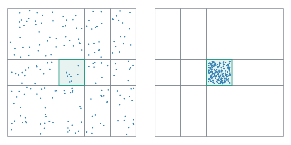

# Benchmarks

Public constructors only: `MemoizedArray` and `LRUMemoizedArray`, serial and concurrent with 1/8 callers.
All values are **ns/op**. Eight-caller times are elapsed wall time divided by total completed
requests; speedup is concurrent one-caller time divided by eight-caller time.
**Bold** marks the lowest ns/op in each row, including ties.

## Results

### Fixed ArrayMap

| Cache | Operation | Serial | Concurrent: 1 caller | Concurrent: 8 callers | Speedup |
|---|---|---:|---:|---:|---:|
| MemoizedArray | Read, repeated | 0.8 | 0.76 | **0.088** | 8.6× |
| MemoizedArray | Read, varying | 0.79 | 0.76 | **0.087** | 8.7× |
| MemoizedArray | Generate | 5 | 3.7 | **0.49** | 7.5× |
| MemoizedArray | Generate + evict | — | — | — | — |
| LRUMemoizedArray | Read, repeated | 2.9 | 4.8 | **0.53** | 9.2× |
| LRUMemoizedArray | Read, varying | 3.4 | 5.8 | **0.59** | 9.8× |
| LRUMemoizedArray | Generate | 4.5 | 15 | **1.5** | 9.7× |
| LRUMemoizedArray | Generate + evict | 3.2 | 12 | **1.4** | 8.0× |

### ExpandingArrayMap

| Cache | Operation | Serial | Concurrent: 1 caller | Concurrent: 8 callers | Speedup |
|---|---|---:|---:|---:|---:|
| MemoizedArray | Read, repeated | 1.3 | 1.3 | **0.16** | 8.2× |
| MemoizedArray | Read, varying | 1.3 | 1.4 | **0.16** | 8.3× |
| MemoizedArray | Generate | 5.5 | 5.9 | **0.77** | 7.6× |
| LRUMemoizedArray | Read, repeated | 3.7 | 6.6 | **0.72** | 9.1× |
| LRUMemoizedArray | Read, varying | 4.3 | 7.9 | **0.86** | 9.2× |
| LRUMemoizedArray | Generate | 4.1 | 17 | **1.9** | 9.2× |
| LRUMemoizedArray | Generate + evict | 4.6 | 19 | **2.5** | 7.6× |

### DictMap

| Cache | Operation | Serial | Concurrent: 1 caller | Concurrent: 8 callers | Speedup |
|---|---|---:|---:|---:|---:|
| MemoizedArray | Read, repeated | 2.7 | 3.3 | **0.44** | 7.6× |
| MemoizedArray | Read, varying | 6.1 | 4.3 | **0.47** | 9.2× |
| MemoizedArray | Generate | 25 | 71 | **23** | 3.0× |
| LRUMemoizedArray | Read, repeated | 5.2 | 12 | **1.1** | 11.0× |
| LRUMemoizedArray | Read, varying | 9 | 14 | **1.4** | 10.2× |
| LRUMemoizedArray | Generate | **24** | 95 | 25 | 3.8× |
| LRUMemoizedArray | Generate + evict | 41 | 137 | **33** | 4.1× |

### 2D ArrayMap controls

| Cache | Operation | Serial | Concurrent: 1 caller | Concurrent: 8 callers | Speedup |
|---|---|---:|---:|---:|---:|
| MemoizedArray | Read central, repeated | 0.8 | 0.91 | **0.12** | 7.9× |
| MemoizedArray | Read central, varying | 0.8 | 0.89 | **0.11** | 7.9× |
| MemoizedArray | Read spread, repeated | 1.4 | 1.3 | **0.15** | 8.7× |
| MemoizedArray | Read spread, varying | 1.6 | 1.3 | **0.14** | 9.0× |
| MemoizedArray | Generate central leaf | 5.7 | 7.2 | **1** | 7.1× |
| MemoizedArray | Generate existing leaves | 6.4 | 5.7 | **1.2** | 4.7× |
| MemoizedArray | Initial generation | 38 | 37 | **5.2** | 7.2× |
| LRUMemoizedArray | Read central, repeated | 2.4 | 3.8 | **0.48** | 7.9× |
| LRUMemoizedArray | Read central, varying | 2.6 | 4.7 | **0.5** | 9.4× |
| LRUMemoizedArray | Read spread, repeated | 4.4 | 7.2 | **0.62** | 11.5× |
| LRUMemoizedArray | Read spread, varying | 5.8 | 9.1 | **0.86** | 10.5× |
| LRUMemoizedArray | Generate central leaf | **8.4** | 30 | 9.2 | 3.3× |
| LRUMemoizedArray | Generate existing leaves | **3.8** | 26 | 3.9 | 6.7× |
| LRUMemoizedArray | Initial generation | 29 | 73 | **9.7** | 7.5× |
| LRUMemoizedArray | Generate + evict, central leaf | 16 | 35 | **13** | 2.7× |
| LRUMemoizedArray | Generate + evict, spread | 28 | 62 | **8.5** | 7.3× |

### RadixMap

| Cache | Operation | Serial | Concurrent: 1 caller | Concurrent: 8 callers | Speedup |
|---|---|---:|---:|---:|---:|
| MemoizedArray | Read central, repeated | 5.3 | 5 | **0.64** | 7.9× |
| MemoizedArray | Read central, varying | 5.1 | 5 | **0.64** | 7.9× |
| MemoizedArray | Read spread, repeated | 8.7 | 7 | **0.8** | 8.8× |
| MemoizedArray | Read spread, varying | 9.9 | 6.9 | **0.79** | 8.8× |
| MemoizedArray | Generate central leaf | 14 | 13 | **3.8** | 3.4× |
| MemoizedArray | Generate existing leaves | 18 | 16 | **2.7** | 5.8× |
| MemoizedArray | Initial generation | 24 | 24 | **5.3** | 4.5× |
| LRUMemoizedArray | Read central, repeated | 7.1 | 8 | **1.1** | 7.6× |
| LRUMemoizedArray | Read central, varying | 7.3 | 9 | **1.1** | 7.9× |
| LRUMemoizedArray | Read spread, repeated | 13 | 14 | **1.4** | 10.0× |
| LRUMemoizedArray | Read spread, varying | 18 | 20 | **1.9** | 10.5× |
| LRUMemoizedArray | Generate central leaf | 20 | 61 | **16** | 3.9× |
| LRUMemoizedArray | Generate existing leaves | 18 | 76 | **10** | 7.4× |
| LRUMemoizedArray | Initial generation | 24 | 87 | **15** | 5.9× |
| LRUMemoizedArray | Generate + evict, central leaf | 32 | 89 | **26** | 3.5× |
| LRUMemoizedArray | Generate + evict, spread | 63 | 111 | **46** | 2.4× |

### SubtreeRadixMap

| Cache | Operation | Serial | Concurrent: 1 caller | Concurrent: 8 callers | Speedup |
|---|---|---:|---:|---:|---:|
| MemoizedArray | Read central, repeated | 1.8 | 2.4 | **0.3** | 7.9× |
| MemoizedArray | Read central, varying | 1.8 | 2.3 | **0.3** | 7.8× |
| MemoizedArray | Read spread, repeated | 8.8 | 7.5 | **0.88** | 8.5× |
| MemoizedArray | Read spread, varying | 10 | 8.2 | **0.9** | 9.1× |
| MemoizedArray | Generate central leaf | 11 | 8.7 | **1.7** | 5.0× |
| MemoizedArray | Generate existing leaves | 20 | 17 | **2.8** | 6.0× |
| MemoizedArray | Initial generation | 33 | 25 | **5.2** | 4.8× |
| LRUMemoizedArray | Read central, repeated | 3.9 | 5.7 | **0.73** | 7.7× |
| LRUMemoizedArray | Read central, varying | 4 | 6.5 | **0.73** | 8.9× |
| LRUMemoizedArray | Read spread, repeated | 13 | 15 | **1.6** | 9.6× |
| LRUMemoizedArray | Read spread, varying | 18 | 20 | **1.9** | 10.6× |
| LRUMemoizedArray | Generate central leaf | 19 | 58 | **14** | 4.1× |
| LRUMemoizedArray | Generate existing leaves | 20 | 82 | **11** | 7.7× |
| LRUMemoizedArray | Initial generation | 35 | 92 | **16** | 5.8× |
| LRUMemoizedArray | Generate + evict, central leaf | 27 | 88 | **23** | 3.7× |
| LRUMemoizedArray | Generate + evict, spread | 77 | 120 | **44** | 2.7× |

### Measurement contract

- The generator returns one preconfigured 4×4 matrix. Each request consumes one matrix element
  in a scalar checksum; no output array is written.
- Compilation, construction, prefill, validation and explicit GC are outside timing.
  GC during requests remains included. Callers prepare empty slots and queue state on their
  measuring core; initial tree creation and dictionary record allocation happen inside timing.
- Caller key sets are disjoint. Concurrent LRU uses one exclusive queue per caller and fixed
  total capacity. Reads begin with queue memberships already populated.
- Setup/post-run checks verify missing targets, retained residents and eviction behavior.
  The regression suite checks zero-allocation matrix reads and reuse where storage already exists.

#### ArrayMap, ExpandingArrayMap and DictMap workloads

Reads: 8,192 resident keys, 4,194,304 requests. Generation: 32,768 distinct missing keys.
Replacement: fill capacity 8,192, then request 32,768 new keys.

Expanding arrays use `increment=8` and an allocation covering all measured keys; these numbers
exclude resizing. Dictionary generation includes record allocation and any table growth.
Dictionary LRU replacement also includes removal and rebuilding. Writes synchronize per hash
partition, while cached reads take no structural lock.

#### Tree workloads

All cases use a 512×512 domain, `block_shape=(8,8)` and `center=0.5`.
The 2D ArrayMap control receives identical coordinates; its strides and memory locality differ.

| Operation | Setup and timed requests |
|---|---|
| Read central / spread | Same population: 8,192 sampled coordinates plus all central-leaf keys. 4,194,304 requests, restricted either to the central leaf or sampled coordinates. LRU capacity 8,256. |
| Generate central leaf | 64 caches, each with 1 central + 448 scattered values. Generate the other 63 central values; LRU capacity 512. No node creation or eviction. |
| Generate existing leaves | Seed every needed leaf, then generate 32,768 distributed values. LRU capacity 36,864. |
| Initial generation | Same distributed requests from an empty cache; includes node creation. LRU capacity 32,768. Concurrent Subtree constructs its permanent central leaf before timing. |
| Generate + evict, central leaf | 64 caches of capacity 512; prefill 32 central values before 480 scattered values, then replace those 32 central values. Reuse entries in the retained leaf; no structural removal. |
| Generate + evict, spread | Capacity 8,192, then 32,768 distinct distributed requests. Includes entry reuse, creation of missing nodes and pruning of empty nodes. |

Central batches include one cache-reference load per request. Seven/eight-key caller shares
limit ideal central-generation scaling to 7.875×. Neighboring callers can share slot cache lines.
Ratios above 8× on reads can reflect smaller per-core working sets.



Squares represent leaves; green marks the central leaf. Equal-size dots show the two sampling
patterns. Regenerate the transparent SVGs with `python docs/plot_tree_sampling.py` (Matplotlib).

### Reproduce the results

The entry point `benchmark.jl` handles workers, timing and reporting;
`benchmark/workloads.jl` defines cache setup and requests. The harness defaults to
fixed ArrayMap. Select other cases through `QUEUE_CASES`:

```sh
julia --startup-file=no --compiled-modules=existing --project=. -t 8 benchmark.jl

QUEUE_CASES=memoized-serial,memoized,lru-serial,lru,expanding-serial,expanding,expanding-lru-serial,expanding-lru,dict-serial,dict,dict-lru-serial,dict-lru \
    julia --startup-file=no --compiled-modules=existing --project=. -t 8 benchmark.jl

QUEUE_CASES=array2d-serial,array2d,array2d-lru-serial,array2d-lru,radix-serial,radix,radix-lru-serial,radix-lru,subtree-serial,subtree,subtree-lru-serial,subtree-lru \
    QUEUE_OPERATIONS=read-central,read-spread,generate-central,generate-existing,generate-structural,evict-central,evict-spread \
    julia --startup-file=no --compiled-modules=existing --project=. -t 8 benchmark.jl
```

Use `QUEUE_READ_PATTERN=varying` for precomputed uniform reads with replacement; the default
cycles a fixed shuffled sequence. Use `QUEUE_OPERATIONS=read` (trees: `read-central,read-spread`)
to measure only reads. `QUEUE_ROUNDS=15` and `QUEUE_CALLERS=1,8` are defaults.
For serial/one-caller checks on fewer threads, set `QUEUE_CALLERS=1`.
Eviction workloads share `QUEUE_CAPACITY` (resident capacity, default 8192) and
`QUEUE_EVICT_COUNT` (requests, default 32768), including `evict-spread` for trees.
`QUEUE_TREE_EVICT_CAPACITY` has been removed; use `QUEUE_CAPACITY` instead.
Central tree batches retain their fixed 512-entry geometry.

Recorded runs: Julia 1.13.0, Ryzen 9 7950X, 2026-10-09, 15 rotated rounds.
Linux affinity: `QUEUE_PIN=true QUEUE_CPU_OFFSET=8 QUEUE_PRODUCER_CPU=0` puts callers on
physical cores 8–15 and the coordinator on core 0. Calls start against a shared deadline;
the harness reports overlap, start skew and interquartile spread.
