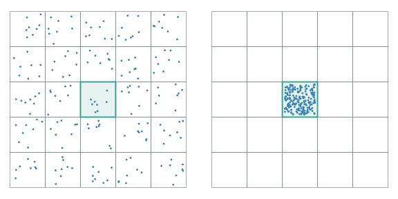

# Benchmarks

All values are ns/request. Each request consumes one element of a preconfigured 4×4 matrix
in a scalar checksum; compilation and setup are outside timing.

## Results

| Map | Cache | Read: serial | Read: 8 callers | Generate: serial | Generate: 8 callers |
|---|---|---:|---:|---:|---:|
| `ArrayMap` | `MemoizedArray` | 0.80 | **0.088 (9.1×)** | 5.0 | **0.49 (10.2×)** |
| `ArrayMap` | `LRUMemoizedArray` | 2.9 | **0.53 (5.5×)** | 3.2 | **1.4 (2.3×)** |
| `ExpandingArrayMap` | `MemoizedArray` | 1.3 | **0.16 (8.1×)** | 5.5 | **0.77 (7.1×)** |
| `ExpandingArrayMap` | `LRUMemoizedArray` | 3.7 | **0.72 (5.1×)** | 4.6 | **2.5 (1.8×)** |
| `DictMap` | `MemoizedArray` | 2.7 | **0.44 (6.1×)** | 25 | **23 (1.1×)** |
| `DictMap` | `LRUMemoizedArray` | 5.2 | **1.1 (4.7×)** | 41 | **33 (1.2×)** |
| `RadixMap` | `MemoizedArray` | 5.3 | **0.64 (8.3×)** | 24 | **5.3 (4.5×)** |
| `RadixMap` | `LRUMemoizedArray` | 7.1 | **1.1 (6.5×)** | 63 | **46 (1.4×)** |
| `SubtreeRadixMap` | `MemoizedArray` | 1.8 | **0.30 (6.0×)** | 33 | **5.2 (6.3×)** |
| `SubtreeRadixMap` | `LRUMemoizedArray` | 3.9 | **0.73 (5.3×)** | 77 | **44 (1.8×)** |

`Read` is a warmed cyclic lookup. `Generate` fills missing entries; for LRU caches it starts
full and therefore includes replacement. Tree generation uses spread requests and includes
structural path creation. Parentheses show serial throughput divided by eight-caller throughput.
Recorded on Julia 1.13.0 and a Ryzen 9 7950X with 15 rotated rounds.

## Reproduce

```sh
# Fixed-array baseline: warm hit, cold fill, and LRU churn.
julia --startup-file=no --compiled-modules=existing --project=. -t 8 benchmark.jl

# Tree overview: radix versus subtree routing, structural creation, and LRU churn.
QUEUE_CASES=radix-serial,radix,subtree-serial,subtree,subtree-lru-serial,subtree-lru \
    QUEUE_OPERATIONS=read-central,generate-structural,evict-spread \
    julia --startup-file=no --compiled-modules=existing --project=. -t 8 benchmark.jl

# Bulk array interface: contiguous and strided 128×64 selections.
julia --project=. benchmark/slices.jl
```

The harness reports wall-clock ns/request, start skew, and overlap for one and eight
callers. Use `QUEUE_CALLERS=1` for a single-caller run. `QUEUE_ROUNDS=15` is the default.
`QUEUE_CAPACITY` and `QUEUE_EVICT_COUNT` control the LRU workload sizes.

`benchmark/nested_generators.jl` is a focused allocation/compiler diagnostic for nested
generator captures. It is intentionally separate from the overview above.



Squares represent tree leaves; green marks the central leaf. Equal-size dots show the
central and spread request patterns.
