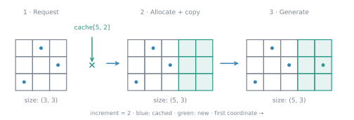
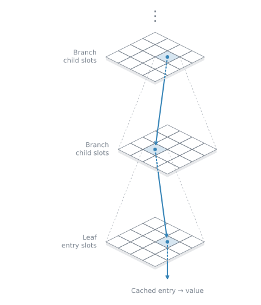

# Examples

```@meta
CurrentModule = MemoizedArrays
```


## MemoizedArray
In the simplest case we can use conventional arrays via `ArrayMap`
```@example basic
using MemoizedArrays # hide
generator(i, j) = i + j;
values = MemoizedArray(generator, ArrayMap{Int}((100, 100)));
values[2, 3]
```
`MemoizedArray` stores any generated values - it does not evict old and unused values. Use `ArrayMap` for a fixed finite domain.

The `do` syntax in combination with explicit value declarations allows for generators that reference other array values 

```@example recursive
using MemoizedArrays # hide
values = MemoizedArray(ArrayMap{Int}((8,))) do i
    values[i - 1] + 1
end;
values[1] = 1;
values[8]
```

For performance-sensitive nested generators, consider capturing dependencies through a concretely typed `Ref` and accessing them with `dependency_ref[]`. Alternatively, wrap a generator with `generator_ref = Ref(generator)` and pass `(indices...) -> generator_ref[](indices...)` to the cache constructor. This can reduce allocations in some dynamically dispatched lookup paths; benchmark warmed lookups, and avoid `Ref{Any}`, which loses type information.

## LRUMemoizedArray
`LRUMemoizedArray` retains at most `capacity` generated values, to balance generation cost with memory utilisation. 

```@example lru
using MemoizedArrays # hide
values = LRUMemoizedArray(identity, ArrayMap{Int}((10,)); capacity=2);
values[1], values[2], values[1], values[3]
```

```@example lru
isready(values, 2)
```

### Pinned starting values

```@example pinned
using MemoizedArrays # hide
values = LRUMemoizedArray(ArrayMap{Int}((8,)); capacity=2) do i
    values[i - 1] + 1
end;
values[1] = 1;
values[8], values[1]
```

- Manual assignments create fresh pinned entries outside the pool and `capacity`.
- Overwrites release the old pooled entry for reuse. Pinned reads skip queue updates.
- Concurrent assignments use a queue handle: `handle[1] = 1`.
- Generator dependencies must be acyclic.

## ExpandingArrayMap
Expanding arrays grow incrementally to allow requests beyond existing array bounds.  


```@example expanding
using MemoizedArrays # hide
values = MemoizedArray(+, ExpandingArrayMap{Int}((3, 3); increment=2));
values[5, 2]
```

```@example expanding
size(values)
```

## RadixMap
Sparse data can be stored via `RadixMap`, via an expanding radix tree, to 


```@example radix
using MemoizedArrays # hide
values = MemoizedArray(tuple, RadixMap{Tuple{Int,Int}}(unbound(2); block_shape=(8, 8)));
values[-200, 300]
```

Use `SubtreeRadixMap` for a tree map whose requests cluster near zero:

```@example subtree
using MemoizedArrays # hide
values = MemoizedArray(tuple, SubtreeRadixMap{Tuple{Int,Int}}(unbound(2); block_shape=(8, 8)));
values[0, -1]
```

## DictMap

```@example dict
using MemoizedArrays # hide
values = LRUMemoizedArray(identity, DictMap{Int}(unbound(1)); capacity=512);
values[-20]
```

## Concurrent MemoizedArray

Set `concurrent=true` to share a cache between tasks.

```julia
values = MemoizedArray(i -> fill(Float64(i), 4, 4),
    ArrayMap{Matrix{Float64}}((1000,)); concurrent=true)
tasks = [Threads.@spawn values[7] for _ in 1:4]
fetch.(tasks)
```

Concurrent requests for the same missing coordinate generate it once; other callers wait.

## Concurrent LRUMemoizedArray

Concurrent LRU access uses one queue per active caller. For example, with
`julia --threads=n`, use `queues=n` and a capacity divisible by `n`.
Each queue tracks recent accesses through references to shared entries.

```@raw html
<iframe src="assets/lru-animation.html" title="LRU access and eviction animation"
    style="display:block; width:100%; height:440px; border:0; background:transparent;"></iframe>
```

```julia
n = Threads.nthreads(:default)
values = LRUMemoizedArray(identity, ArrayMap{Int}((1000,));
     capacity=128*n, concurrent=true, queues=n)
handles = queue_handles(values)
tasks = [Threads.@spawn sum(handles[q][i] for i in 1:100) for q in 1:n]
fetch.(tasks)
```

Alternatively, start one worker task per thread and use `with_queue` to claim a
caller once per worker. Reuse that caller across many runs; its queue is released
when the block finishes:

```julia
tasks = [
    Threads.@spawn begin
        with_queue(values) do caller
            [sum(caller[i] for i in 1:100) for run in 1:100]
        end
    end for _ in 1:n
]
fetch.(tasks)
```

Use one caller per queue. Do not mix automatic selection with explicit handles concurrently
on the same cache.
