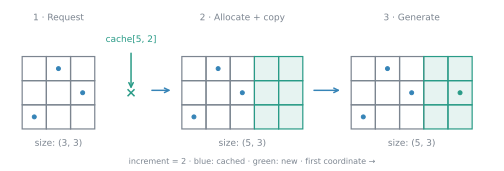
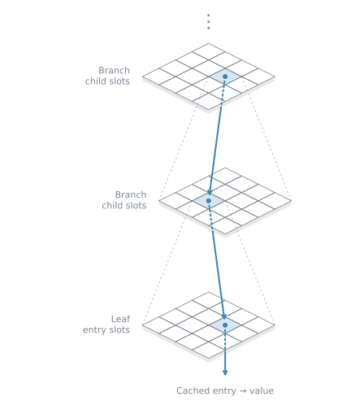
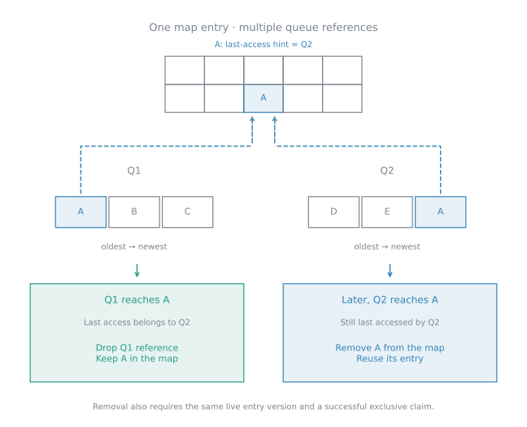

# Examples

```@meta
CurrentModule = MemoizedArrays
DocTestSetup = :(using MemoizedArrays)
```


## MemoizedArray
In the simplest case we generate a conventional array via `ArrayMap`
```jldoctest
julia> value_at(i, j) = i + j;

julia> values = MemoizedArray(value_at, ArrayMap{Int}((100, 100)));

julia> values[2, 3]
5
```

`MemoizedArray` keeps generated values. Use `ArrayMap` for a fixed finite domain.

The generator can request earlier values from the same array:

```jldoctest
julia> values = MemoizedArray(ArrayMap{Int}((8,))) do i
           values[i - 1] + 1
       end;

julia> values[1] = 1;

julia> values[8]
8
```

Dependencies must be acyclic: a generator cannot request its own unfinished value.

## LRUMemoizedArray

```jldoctest
julia> values = LRUMemoizedArray(identity, ArrayMap{Int}((10,)); capacity=2);

julia> values[1], values[2], values[1], values[3]
(1, 2, 1, 3)

julia> isready(values, 2)
false
```

`LRUMemoizedArray` retains at most `capacity` values and regenerates evicted ones.

## ExpandingArrayMap



```jldoctest
julia> values = MemoizedArray(+, ExpandingArrayMap{Int}((3, 3); increment=2));

julia> values[5, 2]
7

julia> size(values)
(5, 3)
```

Growth applies only above the initial upper bounds. `increment` accepts one integer or one
integer per axis, such as `(2, 4)`.

## RadixMap



```jldoctest
julia> values = MemoizedArray(tuple, RadixMap{Tuple{Int,Int}}(unbound(2); block_shape=(8, 8)));

julia> values[-200, 300]
(-200, 300)
```

Use `SubtreeRadixMap` for a tree map whose requests cluster near zero:

```jldoctest
julia> values = MemoizedArray(tuple, SubtreeRadixMap{Tuple{Int,Int}}(unbound(2); block_shape=(8, 8)));

julia> values[0, -1]
(0, -1)
```

## DictMap

```jldoctest
julia> values = LRUMemoizedArray(identity, DictMap{Int}(unbound(1)); capacity=512);

julia> values[-20]
-20
```

## Indexing, views and generation

```jldoctest
julia> values = MemoizedArray(tuple, ArrayMap{Tuple{Int,Int}}((-3:3, 0:4)));

julia> view(values, -2:2, 0:3)[1, 1]
(-2, 0)

julia> generate!(values, ((-3, 4), (3, 0))) === values
true
```

Slices return ordinary arrays. A view generates only when it is read.

## Concurrent MemoizedArray

Start Julia with, for example, `julia --threads=8`.

```julia
values = MemoizedArray(i -> fill(Float64(i), 4, 4),
                  ArrayMap{Matrix{Float64}}((1000,)); concurrent=true)
tasks = [Threads.@spawn values[7] for _ in 1:4]
fetch.(tasks)
```

Concurrent requests for the same missing coordinate generate it once; other callers wait.

## Concurrent LRUMemoizedArray



```julia
values = LRUMemoizedArray(identity, ArrayMap{Int}((1000,));
                  capacity=512, concurrent=true, queues=8)
handles = queue_handles(values)
tasks = [Threads.@spawn handles[i][i] for i in eachindex(handles)]
fetch.(tasks)
```

Or let the cache claim a queue for one operation:

```julia
with_queue(values) do handle
    handle[1]
end
```

Use one caller per queue. Do not mix automatic selection with explicit handles concurrently
on the same cache.
